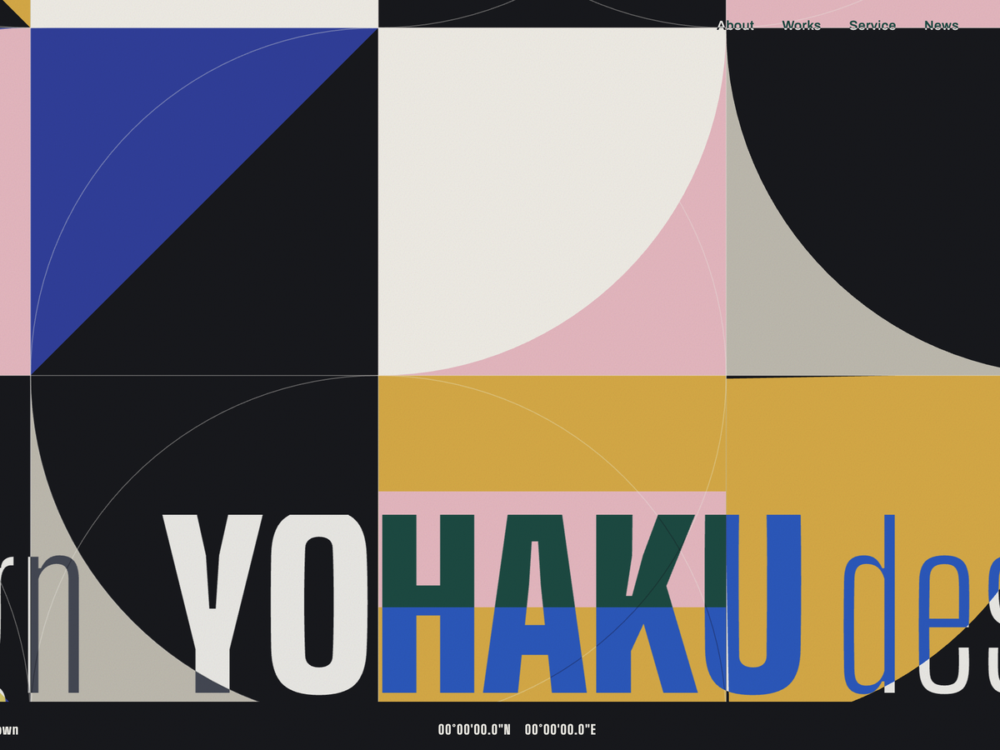

# Yohaku design — WordPress オリジナルテーマ

デザイン会社「Yohaku design」（架空の会社）のために制作した、WordPress のオリジナルテーマです。
静的 HTML で制作したサイトを、WordPress テーマへ移植しました。

ポートフォリオ用の制作物です。実在する会社・団体とは関係ありません。



- 静的 HTML 版：https://helpmark-pink.github.io/dezain/

---

## ブラウザですぐに試す

サーバーを用意せずに、ブラウザの中だけで動かせます。
ポートフォリオサイトの作品ページから「ブラウザでデモを動かす」で開けます。

デモはお知らせ8件（4カテゴリー）、クリエイター3人、連絡先、記事のひな形と、
トップ / About / Works / Service / News / Contact の各ページが登録済みの状態で起動します。
管理画面には `admin` / `password` でログインした状態なので、`/wp-admin/` を開けばそのまま編集できます。

（サイト側の管理バーは、デザインが隠れないよう非表示にしています。
デモ用のデータは `_playground/` にあり、通常のテーマ表示では読み込まれません）

---

## このテーマでできること

| 管理画面から更新できるもの | 使っている仕組み |
| --- | --- |
| お知らせ（写真・カテゴリー・画像の下のテキスト） | WordPress 標準の投稿 ＋ 自作の入力欄 |
| クリエイター（名前・紹介文・ポートレート・担当プロジェクト） | カスタム投稿タイプ `creator` ＋ 自作の入力欄 |
| 郵便番号・住所・メールアドレス | 管理画面に追加した「連絡先」ページ |
| 各ページの本文 | 固定ページ |

お知らせを1件追加すると、トップページの新着、お知らせ一覧、個別ページに反映されます。

---

## 主な実装

### ページごとに CSS と JS を入れ替える

静的 HTML では、ページごとに読み込む CSS と JS が違いました。
WordPress でも同じ組み合わせになるよう、`functions.php` でページごとに入れ替えています。

- three.js はトップ・About・Works・Service だけで読み込みます
- お問い合わせとお知らせ記事では p5.js も外します
- バージョンにはファイルの更新時刻（`filemtime()`）を使い、キャッシュを自動で切ります

### クリエイター（カスタム投稿タイプ）

Works ページの「Creators」を管理画面の「クリエイター」で編集できます。
`add_meta_box()` で「担当プロジェクト」と「名前の補足」の入力欄を追加しました。
担当プロジェクトを選ぶと、Works ページの「Creative partner」からそのクリエイターへ移動できます。

- 保存時は nonce と権限を確かめ、決められたプロジェクト番号以外は保存しません
- 同じプロジェクトのクリエイターが複数いても、移動先の ID は1人目にだけ付けます
- 1人も登録されていないときは、元の3人を表示します

### 連絡先の設定ページ

管理画面の左メニュー「連絡先」で、全ページのフッターに出る郵便番号・住所・メールアドレスを変更できます。
記事の本文では次のショートコードで同じ値を呼び出せます。

| ショートコード | 表示 |
| --- | --- |
| `[aa6_postal]` | 郵便番号 |
| `[aa6_address]` | 住所（改行もそのまま） |
| `[aa6_email]` | メールアドレスのリンク（`link="no"` で文字だけ） |

### 記事を書きやすくする工夫

- アイキャッチ画像の下に出す説明文の入力欄（空のときは画像のキャプションを表示）
- リストブロックの「ポイント」スタイル（01 / 02 … の番号付きリストになる）
- 関連記事は同じカテゴリーを優先し、足りなければ新しい記事で埋める

---

## ファイル構成

```
header.php              トップページのヘッダー（ローディング演出つき）
header-{about,works,service,news,contact}.php
                        各ページのヘッダー
index.php               トップページ
page-about.php          About
page-works.php          Works（制作実績とクリエイター）
page-service.php        Service
page-news.php           お知らせ一覧（10件ごとのページ送り）
page-contact.php        お問い合わせ（入力・確認・完了の3ステップ）
single.php              お知らせ記事
footer.php              フッター
functions.php           読み込みの切り分け・投稿タイプ・設定ページ・ショートコード
*.css / *.js            共通とページ別のスタイル・演出
vendor/                 three.js と Works 用のフォント
images/                 写真・ロゴ・ファビコン
```

---

## 使い方

1. このリポジトリを ZIP でダウンロードし、管理画面の「外観 → テーマ → 新規追加 → テーマのアップロード」から追加します
2. テーマを有効化します
3. 固定ページを次のスラッグで作ります：`about` / `works` / `service` / `news` / `contact`
4. 「設定 → パーマリンク」で「投稿名」を選んで保存します

お問い合わせフォームは見た目と入力チェックのデモです。送信はしません（`page-contact.php` で入力欄を無効にしています）。

---

## 使用しているライブラリ・フォント

- [p5.js](https://p5js.org/)（CDN から読み込み）— LGPL-2.1
- [three.js](https://threejs.org/) — MIT（`vendor/three-LICENSE.txt`）
- Barlow Condensed / Bodoni Moda — SIL Open Font License（`vendor/*-OFL.txt`）
- Archivo / Big Shoulders Display / Zen Kaku Gothic New — Google Fonts から読み込み

## ライセンス

GNU General Public License v2 or later
